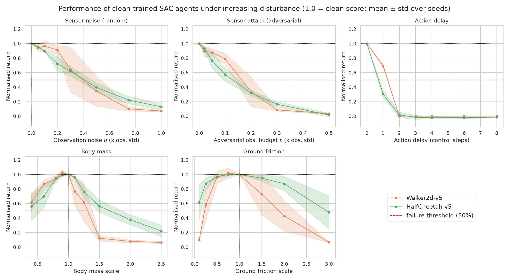

# Robust RL under Environmental Uncertainty and Adversarial Disturbances

**Author:** Ayush Chauhan (`2023B5A71089P`) — Department of Computer Science

> **Quick Links for Presentation & Report:**
> * **[Mid-Semester Presentation Slide Deck (`presentation/slides.md`)](presentation/slides.md)**
> * **[Mid-Semester Report PDF (`presentation/midsem_report.pdf`)](presentation/midsem_report.pdf)**
> * **[Mid-Semester Report Markdown (`presentation/midsem_report.md`)](presentation/midsem_report.md)**
> * **[LaTeX Report Source (`presentation/report_format/main.tex`)](presentation/report_format/main.tex)**

---

## Project Overview

Standard Deep Reinforcement Learning agents are trained and evaluated in identical, noise-free simulation environments ($\mathcal{M}_{\text{test}} = \mathcal{M}_{\text{train}}$). In real-world deployment, agents face sensor noise, adversarial spoofing, actuation latency, and shifted physical parameters.

In this mid-semester phase, we train **Soft Actor-Critic (SAC)** baseline policies on two contrasting continuous-control MuJoCo locomotion benchmarks—**`Walker2d-v5`** (an upright bipedal walker vulnerable to falling) and **`HalfCheetah-v5`** (a mechanically stable planar runner)—and systematically stress-test them across **five graded disturbances** spanning three interaction channels:

| # | Channel | Disturbance Type | Code Identifier | Intensity Unit |
| :-: | :--- | :--- | :--- | :--- |
| **1** | **Sensor Input** | Random Gaussian Sensor Noise | `obs_noise` | $\sigma$ (multiple of per-dimension state std $\sigma_s$) |
| **2** | **Sensor Input** | White-Box PGD Adversarial Attack | `obs_adv` | $\epsilon$ (multiple of per-dimension state std $\sigma_s$) |
| **3** | **Actuator** | Control-Step Action Delay | `act_delay` | Delayed control steps ($k \in \{0, 1, 2, 3, 4\}$) |
| **4** | **Physics** | Body Mass & Inertia Scaling | `mass` | Multiplier (0.4× to 2.5×) |
| **5** | **Physics** | Ground Sliding Friction Scaling | `friction` | Multiplier (0.1× to 3.0×) |

---

## Key Results Preview



* **Action Delay is Catastrophic:** A single step of latency reduces return by **31%** on `Walker2d-v5` and **70%** on `HalfCheetah-v5`; 2 steps causes total failure (0% score).
* **Adversarial Attacks Are 2.4× to 3.2× Stronger Than Random Noise:** White-box 10-step PGD attacks on the agent's Critic break policies at 2.4× to 3.2× smaller budgets than random Gaussian noise and induce twice the action deviation $\lVert\pi(\tilde{s}) - \pi(s)\rVert_2$.
* **Asymmetric Physics & Task Mechanics:** Heavier body masses ($\ge 1.31\times$ on `Walker2d`) break policies rapidly due to actuator torque saturation, whereas lighter masses never drop below 50%. Low friction (0.22×) causes `Walker2d-v5` to slip and fall, while `HalfCheetah-v5` retains 62% of its score even at 0.1× friction.

---

## Repository Structure

```text
├── presentation/                  # Self-contained presentation & report package
│   ├── slides.md                  # Markdown presentation slide deck (GitHub-rendered)
│   ├── midsem_report.pdf          # Compiled LaTeX mid-semester report (PDF)
│   ├── midsem_report.md           # Markdown mid-semester report
│   ├── figures/                   # All high-resolution experiment plots
│   ├── tables/                    # Summary CSV tables (clean scores, breaking points)
│   ├── code/                      # Clean 2-model, 5-perturbation Python scripts
│   └── report_format/             # LaTeX source (main.tex, main.sty, references.bib)
├── src/                           # Source package (train, perturbations, evaluate, analyze)
├── scripts/                       # Pipeline execution scripts (run_all.sh, benchmark.sh)
├── runs/                          # Trained SAC model checkpoints & evaluation curves
├── results/eval/                  # Raw per-episode stress-test CSV logs
└── report/                        # Report figures and tables
```

---

## Setup & Reproduction

```bash
uv venv ~/rlenv --python 3.11
source ~/rlenv/bin/activate
uv pip install -r requirements.txt

# Run full pipeline (train -> stress test -> generate figures & tables)
bash scripts/run_all.sh
```
