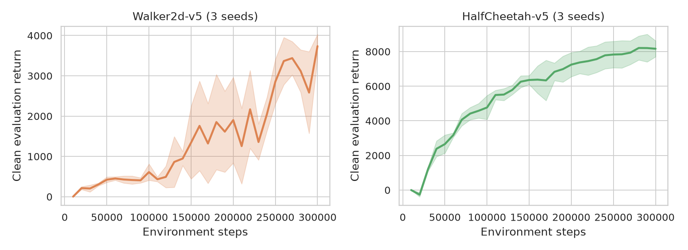
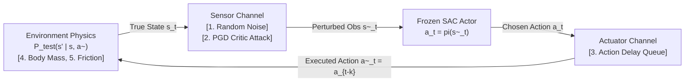
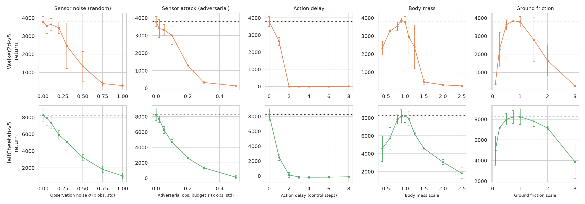
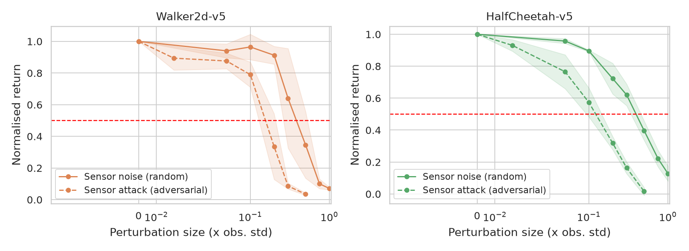
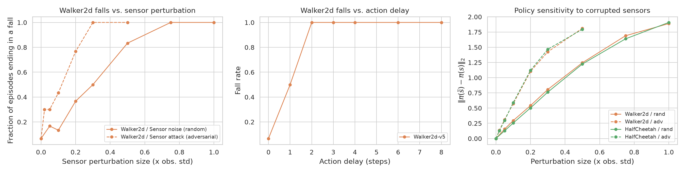
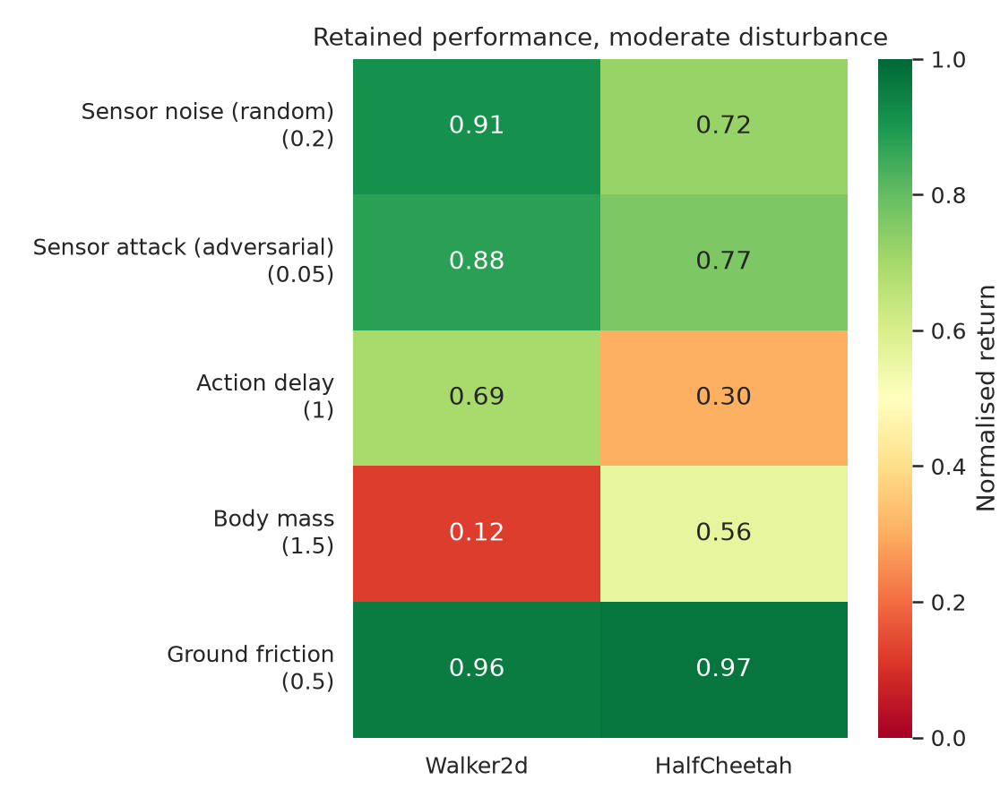
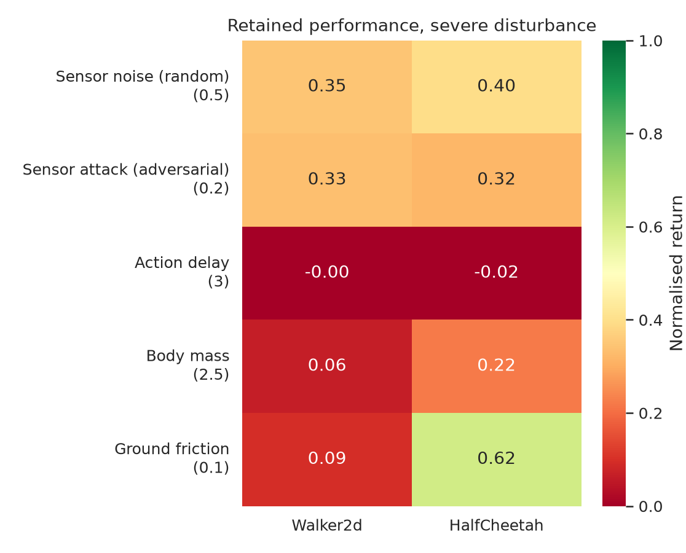

# Robust Reinforcement Learning under Environmental Uncertainty and Adversarial Disturbances
### Mid-Semester Presentation
**Author:** Ayush Chauhan (`2023B5A71089P`) — Department of Computer Science

---

## Problem Statement & Motivation

### Why Standard RL Fails in the Real World
In standard Reinforcement Learning, an agent is trained and tested in the **exact same Markov Decision Process (MDP)**:

$$
M_{\mathrm{train}} = (\mathcal{S}, \mathcal{A}, P_{\mathrm{train}}, R, \gamma)
$$

When deployed on a physical system ($M_{\mathrm{test}} \neq M_{\mathrm{train}}$), three assumptions break:
1. **Imperfect / Attacked Sensors:** Observations are corrupted by random noise or targeted adversarial attacks ($\tilde s_t \neq s_t$).
2. **Actuation Latency:** Motor commands experience communication or mechanical delay ($\tilde a_t = a_{t-k}$).
3. **Shifted Physics (Sim-to-Real Gap):** Payload mass, inertia, and ground friction differ from training ($P_{\mathrm{test}} \neq P_{\mathrm{train}}$).

### Core Research Questions
* **RQ1 (Mid-Sem Focus — Diagnosis):** When we take a clean-trained RL policy and gradually increase disturbance intensity across different channels, which shift breaks the agent fastest, and why?
* **RQ2 & RQ3 (End-Sem Focus — Defense & Transfer):** Does a robustness strategy trained for one disturbance channel transfer to unseen channels, and can we train a unified multi-channel defense?

---

## Environments & Baseline Algorithm (SAC)

### Two Contrasting Continuous-Control Benchmarks (MuJoCo)
Both environments share the exact same dimensions (**17-D continuous state space** $\mathbb{R}^{17}$, **6-D continuous action space** $[-1, 1]^6$), isolating the role of **mechanical stability**:

| Environment | State $\mathcal{S}$ | Action $\mathcal{A}$ | Control Step $\Delta t$ | Mechanical Stability & Failure Mode |
| :--- | :---: | :---: | :---: | :--- |
| **`Walker2d-v5`** (Bipedal Walker) | $\mathbb{R}^{17}$ | $[-1, 1]^6$ | 8 ms | **Unstable:** Must actively balance its torso; terminates early if it **falls**. |
| **`HalfCheetah-v5`** (Planar Runner) | $\mathbb{R}^{17}$ | $[-1, 1]^6$ | 50 ms | **Mechanically Stable:** Cannot fall (always runs 1,000 steps); tests gait coordination. |

### Why Soft Actor-Critic (SAC) Instead of Tabular TD or Monte Carlo?
* **Continuous Spaces** ($\mathbb{R}^{17} \times [-1,1]^6$): Tabular Q-learning cannot store infinite states, and standard greedy maximization $\arg\max_a Q(s,a)$ cannot search over infinite continuous motor torques.
* **Why Not Monte Carlo?** 1,000-step episodes create high return variance, and on-policy updates discard past data.
* **How SAC Solves Both:**
  1. **Twin Critics** $Q_{\phi_1}(s,a), Q_{\phi_2}(s,a)$ (**1-Step Off-Policy TD Learning**): Reuses a $10^6$-transition Replay Buffer with low variance; takes $\min(Q_1, Q_2)$ to prevent overestimation bias.
  2. **Actor Network** $\pi_\theta(s)$ (**Continuous Greedy + Entropy Exploration**): Learns to output the continuous action maximizing $Q(s,a)$ plus an **Entropy bonus** $\alpha \mathcal{H}(\pi(\cdot \mid s))$ for smooth exploration during training. At test time, we freeze $\pi_\theta(s)$ and use the deterministic greedy mean action.

### Clean Baseline Training Results (300,000 Steps × 3 Seeds)

| Environment | Clean Baseline Return (Mean ± Std) | Mean Episode Length | Clean Fall Rate |
| :--- | :---: | :---: | :---: |
| **`HalfCheetah-v5`** | **8245.5 ± 765.0** | 1000.0 steps | 0.0% (cannot fall) |
| **`Walker2d-v5`** | **3788.3 ± 287.6** | 980.2 steps | 6.7% |

---

## Experimental Methodology — The 5 Disturbances

We freeze the trained Actor policy $\pi_\theta(s)$ and stress-test it across **5 graded disturbances** spanning **3 channels** (2,580 evaluation episodes using **Common Random Numbers** so initial states are identical across all tests):

| # | Channel | Disturbance | Mathematical Formulation | Intensity Unit ($\epsilon$) | Effect on MDP |
| :-: | :--- | :--- | :--- | :--- | :--- |
| **1** | **Sensor** | Random Noise (`obs_noise`) | $\tilde s_t = s_t + \epsilon \sigma_s \odot \mathcal{N}(0, I)$ | Multiple of state std $\sigma_s$ | Corrupts policy input $\pi(\tilde s_t)$ only; true physics unchanged. |
| **2** | **Sensor** | Adversarial Attack (`obs_adv`) | $\tilde s_t = s_t + \arg\min_{\lvert\delta_i\rvert \le \epsilon \sigma_{s,i}} Q(s_t, \pi(s_t + \delta))$ | Multiple of state std $\sigma_s$ | 10-step White-Box PGD finds worst-case sensor illusion. |
| **3** | **Actuator** | Action Delay (`act_delay`) | $\tilde a_t = a_{t-\epsilon}$ (FIFO queue) | Control steps ($0, 1, 2, 3, 4$) | Breaks Markov property; policy acts on stale state. |
| **4** | **Physics** | Body Mass (`mass`) | $m_b \leftarrow \epsilon m_b, \quad I_b \leftarrow \epsilon I_b$ | Multiplier (0.4× to 2.5×) | Alters true transition kernel $P_{\mathrm{test}}(s' \mid s, a)$. |
| **5** | **Physics** | Ground Friction (`friction`) | $\mu_{\mathrm{slide}} \leftarrow \epsilon \mu_{\mathrm{slide}}$ | Multiplier (0.1× to 3.0×) | Alters foot-ground contact dynamics $P_{\mathrm{test}}(s' \mid s, a)$. |

> **Note:** Why is Reward Corruption not tested here? Because at test time, weights are frozen and $\pi_\theta(s)$ never reads rewards $r_t$. Reward corruption only affects training-time Bellman updates.

---

## Main Results — Degradation Curves Across All 5 Disturbances

We normalize every perturbed score by the agent's own clean baseline score ($\bar J = J_{\mathrm{perturbed}} / J_{\mathrm{clean}}$) and measure:
* **Degradation Onset** ($\epsilon_{80}$): Intensity where normalized score $\bar J$ drops below **80%** (20% loss).
* **Breaking Point** ($\epsilon_{50}$): Intensity where normalized score $\bar J$ drops below **50%** (red dashed line).

### Absolute Return Comparison (Baseline vs. Perturbed)

### Exact Breaking-Point Table (Onset $\epsilon_{80}$ / Failure $\epsilon_{50}$)

| Disturbance Type | Direction / Unit | `Walker2d-v5` ($\epsilon_{80}$ / $\epsilon_{50}$) | `HalfCheetah-v5` ($\epsilon_{80}$ / $\epsilon_{50}$) | Key Observation |
| :--- | :--- | :---: | :---: | :--- |
| **1. Sensor Noise (`obs_noise`)** | $\sigma$ (in units of $\sigma_s$) | 0.24 / **0.40** | 0.16 / **0.41** | Gradual decay; fails at ~40% sensor noise. |
| **2. Sensor Attack (`obs_adv`)** | $\epsilon$ (in units of $\sigma_s$) | 0.09 / **0.16** | 0.04 / **0.13** | **2.4× to 3.2× deadlier** than random noise! |
| **3. Action Delay (`act_delay`)** | Control steps | 0.65 / **1.28** | 0.29 / **0.72** | **Most destructive:** 1 step drops 31%–70%; 2 steps = 0%. |
| **4. Body Mass (`mass`)** | Heavier ($\uparrow$) | ×1.09 / **×1.31** | ×1.22 / **×1.67** | Heavy loads saturate motor torques and cause collapse. |
| **4. Body Mass (`mass`)** | Lighter ($\downarrow$) | ×0.55 / Never | ×0.68 / Never | Strongly **asymmetric**: lighter mass never drops below 50%. |
| **5. Ground Friction (`friction`)** | Slippery ($\downarrow$) | ×0.39 / **×0.22** | ×0.21 / Never | `Walker2d` slips and falls on ice; `HalfCheetah` keeps 62%! |
| **5. Ground Friction (`friction`)** | Sticky ($\uparrow$) | ×1.37 / **×1.88** | ×2.19 / **×2.94** | High friction trips bipedal foot clearance faster. |

---

## Deep Dive — Random Noise vs. Adversarial Attack & Failure Mechanics

### 1. Random Gaussian Noise vs. White-Box PGD Critic Attack

* **Why is the PGD Attack 2.4× to 3.2× Stronger at the Exact Same Budget?**
  * Random noise adds an isotropic vector in $\mathbb{R}^{17}$—most of those directions are orthogonal to the neural network's decision boundary and cancel out.
  * Our 10-step PGD attack uses $\nabla_\delta Q(s_t, \pi_\theta(s_t + \delta))$ to push the observation along the **steepest descent direction of the Critic**, tricking the Actor into selecting the worst possible torque for the current state $s_t$.
  * On `HalfCheetah-v5`, an adversarial nudge of just **4.4% of 1 standard deviation** ($\epsilon_{80} = 0.044$) already wipes out 20% of total return!

### 2. How Do the Robots Actually Fail? (Falls & Policy Sensitivity)

* **Left & Middle Panels (Bipedal Falls in `Walker2d-v5`):**
  * Clean `Walker2d-v5` falls in only **6.7%** of episodes.
  * Under adversarial sensor attack ($\epsilon = 0.2$), falls surge to **77%** (and **100%** at $\epsilon = 0.3$).
  * Under action delay, **2 steps of delay causes a 100% fall rate**.
* **Right Panel — Policy Action Deviation** ($\lVert\pi_\theta(\tilde s) - \pi_\theta(s)\rVert_2$):
  * Measures how much the corrupted sensor reading changes the Actor's motor command.
  * At every perturbation size $\epsilon$, the adversarial attack induces **nearly 2× larger action changes** than random noise, proving it exploits high-sensitivity (large local Lipschitz) directions of the policy network.

---

## Summary Heatmaps & End-Semester Roadmap

### Retained Performance Summary (Moderate vs. Severe Disturbances)

| Moderate Disturbance | Severe Disturbance |
| :---: | :---: |
|  |  |

### Key Takeaways from Mid-Semester Phase
1. **Action Delay is #1 Most Damaging:** Memoryless Markovian policies $\pi(s_t)$ cannot handle pipelined action latency. `HalfCheetah-v5` fails faster per step ($\epsilon_{50}=0.72$) than `Walker2d-v5` ($\epsilon_{50}=1.28$) because its control step is 50 ms vs. 8 ms (6.25× longer physical lag per step).
2. **Average-Case vs. Worst-Case Robustness:** Surviving random Gaussian noise up to $\sigma = 0.40$ gives a false sense of security; targeted PGD attacks break the same policy at $\epsilon = 0.13$ to $0.16$.
3. **Physics Asymmetry & Task Mechanics:** Heavier mass hurts far more than lighter mass due to torque saturation; friction shifts hurt balancing bipeds (`Walker2d`) far more than planar runners (`HalfCheetah`).

### Roadmap for End-Semester Phase (From Diagnosis to Defense)
1. **Implement Specialized Robust Training Strategies:**
   * *Sensor Channel:* Gaussian noise augmentation & Lipschitz smoothness regularization (SA-SAC).
   * *Actuator/Dynamics Channel:* Action-history stacking & Domain Randomization over mass/friction.
   * *Distributionally Robust Critic:* Single-trajectory KL-dual pessimistic backup (Liang et al., ICML 2024).
   * *Training-Time Reward Corruption:* Uncertainty-weighted TD loss (Ye et al., ICML 2024).
2. **Cross-Robustness Transfer Matrix:** Train on defense $k$, test on disturbance $k'$ at calibrated magnitudes to test whether robustness transfers across channels.
3. **Proposed Unified Defense:** A **Multi-Channel Stochastic Adversary** (extending ATSA, Zhou et al., ICML 2025) that maximizes adversary entropy across sensor, action, and physics channels simultaneously.
